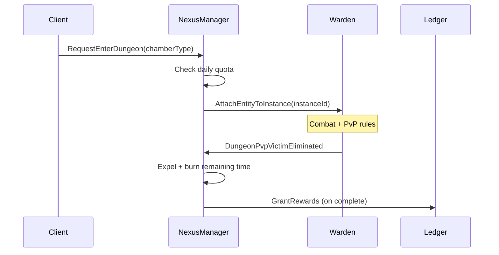

# The Cartographer — Mundo, grid e instancias

**Runtime:** `apps/server` (NestJS) + datos de mundo en DB/config; **cliente** carga geometría/visuals.  
**Misión:** Definir y servir la **estructura espacial** del juego: qué zona tiene qué colisión, cómo se **instancian** mazmorras diarias, y cómo **spawnear** entidades con densidad controlada.

**Blueprint de referencia:** [05-combate-warden-weaver.md](../blueprint/05-combate-warden-weaver.md), [06-mazmorras-diarias-cartographer.md](../blueprint/06-mazmorras-diarias-cartographer.md).

---

## 1. Skill: `MapGrid` — Colisión y perfiles de zona

### Objetivo

Centralizar la política **Body Block** según tipo de zona, coherente con el Warden en validación de movimiento.

| Perfil | Body block (jugador-jugador) | Notas |
|--------|------------------------------|-------|
| **Ciudad / segura** | **OFF** (o relajado: overlap permitido) | Mejor flujo social; combate suele estar restringido por reglas de zona. |
| **Mundo abierto / campo** | **ON** | Colisión completa; pathfinding y empuje validados en servidor. |
| **Instancia dungeon** | **Data-driven** (`instance_collision_profile`) | Puede ser ON para competencia PvP o relajado para PvE masivo; documentar por plantilla. |

### Implementación

- Exponer API interna: `getZoneProfile(zoneId) → { pvpFlags, collision, dungeonType }`.
- El **grid/NavMesh** debe ser la misma fuente para simulación servidor y, vía serialización ligera, para hints del cliente (no duplicar lógica de bloqueo en Weaver).

---

## 2. Skill: `NexusManager` — Dungeons diarias estilo MIR4

### Objetivo

Orquestar **entrada, sesión y salida** de mazmorras diarias con **cámaras especializadas** (Oro / Exp / Drop) y **cuota de tiempo** diaria.

### Parámetros de producto (actual)

| Parámetro | Valor / regla |
|-----------|----------------|
| **Cuota diaria** | **60 minutos / día** por personaje (ajustable en datos; valor acordado para implementación inicial). |
| **Cámaras** | Perfiles de recompensa distintos (tablas de spawn y multiplicadores) según [06](../blueprint/06-mazmorras-diarias-cartographer.md). |
| **Reset** | Alineado con `timezone_server` o UTC único del proyecto. |

### Responsabilidades

| Función | Detalle |
|---------|---------|
| **Elegibilidad** | Comprobar `remainingDailySeconds` antes de crear instancia. |
| **Creación de instancia** | Asignar `instanceId`, shard, seed de spawns, perfil de cámara elegido. |
| **Consumo de tiempo** | Decrementar tiempo solo mientras el jugador está **dentro** y sesión **activa** (pausar si diseño lo exige al estar en menú — por defecto no pausar para anti-AFK). |
| **PvP competitivo** | Marcar instancia con `pvp_mode = DUNGEON_COMPETITIVE`; suscribirse a `DungeonPvpVictimEliminated` del Warden: **expulsar** víctima y **consumir tiempo restante** de su cuota de sesión (ver blueprint 06). |
| **Cierre** | Al agotar tiempo o al completar objetivo, teleport seguro y persistir recompensas vía Ledger en transacción. |

### Anti-abuso

- Una sesión activa por personaje (o reglas de grupo explícitas).
- Logs: `instanceId`, tipo de cámara, tiempo consumido, expulsiones PvP.

---

## 3. Skill: `SpawnController`

### Objetivo

Controlar **densidad de mobs**, **oleadas** y **respawn de bosses** sin saturar ticks ni DB.

### Densidad

- Límites por `zoneId` / instancia: `maxConcurrentMobs`, `spawnBudgetPerTick`.
- Priorizar spawns en AOI con jugadores; dormir spawns lejanos.
- **Hunting grounds v1:** cuatro cuadrantes por zona + plaza central; spots en `mobs.json` (ver blueprint 09). Un spot = un `templateKey`. Packs mixtos sólo con la misma `socialFamily` y niveles a ±2.
- **Piso jugable** (`groundSizeMeters` en `world-zones.json`, v1 = **128**): recorta el plano vacío, no los spots. Juntar packs hacia el origen aumenta GLTF en el frustum y empeora picos de lag. Warden clampa XZ de jugador y mobs al half-extent.
- **Props:** `propTemplateKey` en `map-objects-Zone_*.json` (Weaver). AABB sigue siendo la colisión. No poner props en el centro de un SpawnSpot. Senderos de caza: `floor_path` + `blocksMovement: false` (ejes + codo L hacia ±32). Puesto del mercader en Zone_0 (~5, 5): `cart` / `barrel` / `chest` / `torch` / `pot` **sí** colisionan.

### Bosses

- **Respawn** por `respawnDelayMs` del template (silver dragonkin en el borde este de Zone_1, 1 entidad). Un timer persistente `nextBossSpawnAt` queda para dungeons.
- **Lock de loot** por contribución o primer hit — definido en datos; el Cartographer orquesta **aparición**, el Ledger **entrega** recompensas.

### Coordinación con Warden

- Al spawnear, registrar entidad en el **registro de simulación** del tick con stats desde tablas de mobs.

---

## 4. Flujo de eventos con otros agentes

---

## 5. Datos y tooling

- Formatos de mapa: versión de `mapRevision` en cliente y servidor para evitar desyncs.
- Herramientas offline (futuro): editor de spawns vinculado a `spawn_waves` en DB.

---

## 6. Pruebas

- Unit: consumo de cuota, reset diario simulado, expulsión PvP mockeando evento del Warden.
- Carga: muchas instancias concurrentes con presupuesto de spawn respetado.
