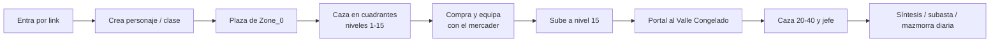
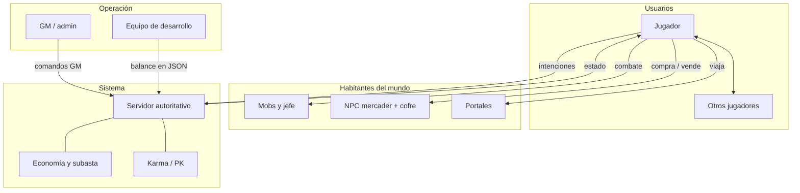

# SDD — Aetheris · Parte 1: Base conceptual

> **Estado:** borrador v1. Cubre los apartados 1 a 4 del enunciado (Introducción, Equipo, Aspectos generales, Usuarios y actores).
> **Cómo leerlo:** todo lo que sale del repo (reglas, zonas, mobs, economía) está citado con su fuente en `docs/blueprint/`. Lo marcado **[COMPLETAR]** lo tiene que aportar el equipo. Lo marcado **[HIPÓTESIS]** es una propuesta de diseño que conviene validar (con encuesta, entrevistas o playtest) antes de presentarla como hecho.

---

## 1. Introducción

**Aetheris** es un MMORPG 3D que se juega en el navegador, sin instalación. Un servidor autoritativo mantiene el mundo persistente y varios jugadores comparten zonas de caza, portales, un mercader y una economía con dos monedas. El cliente solo expresa intenciones (moverse, atacar, comprar); el servidor valida y decide. Esa regla, "el cliente no decide resultados", organiza todo el diseño.

El juego retoma la mecánica de tres MMORPG clásicos y la rearma en un entorno web:

| Referencia | Qué se toma |
|---|---|
| **MU Online** | Cuatro atributos base (STR, AGI, VIT, ENE) y clases como Dark Knight, Dark Wizard y Fairy Elf. |
| **Lineage 2** | Stats derivados (ataque físico/mágico, defensa, velocidad, crítico), paperdoll, karma/PK y sensación de combate. |
| **MIR4** | Mazmorras diarias con tiempo jugable acotado y elección del tipo de recompensa. |

**Alcance de este documento.** El SDD sistematiza el proceso de diseño del entorno virtual: desde el desafío y los usuarios hasta la narrativa, lo sensorial, lo interactivo y la arquitectura. Esta Parte 1 fija la base sobre la que se apoyan las demás: para quién se diseña, qué problema se resuelve y qué actores habitan el mundo.

**Las cuatro dimensiones** que el enunciado pide articular, aplicadas al proyecto:

| Dimensión | En Aetheris |
|---|---|
| Técnica | Navegador (Angular + Three.js), servidor NestJS con Socket.IO a 20 ticks por segundo, persistencia en PostgreSQL (Supabase). |
| Estética | Low poly estilo fantasía (assets Quaternius CC0), zonas contrastantes (pradera / valle nevado), glow de encantamiento y color de estado PvP. |
| Narrativa | **[COMPLETAR en Parte 2]** El blueprint define mecánicas y zonas, pero todavía no un relato ni un lore. |
| Experiencial | Recorrido de novato a cazador de jefes: subir de nivel, cruzar portales, equiparse y arriesgarse (síntesis, PK). |

---

## 2. Organización del equipo de diseño (roles)

### 2.1 Integrantes

El repositorio tiene una sola autoría de commits. El enunciado habla de trabajo en equipo, así que esta tabla la completa el grupo.

| Integrante | Rol de diseño | Responsabilidad principal |
|---|---|---|
| Gastón Guiñazu | **[COMPLETAR]** (p. ej. líder técnico / diseño de sistemas) | Monorepo, servidor, integración. |
| **[COMPLETAR]** | Dirección de arte y UX | Estética visual, moodboard, interfaz. |
| **[COMPLETAR]** | Narrativa y diseño de niveles | Lore, misiones, ambientación de zonas. |
| **[COMPLETAR]** | Sonido, QA y documentación | Diseño sonoro, playtests, SDD y trailer. |

### 2.2 Roles funcionales del proyecto (los cuatro "agentes")

Además de los roles humanos, el proyecto se organiza en **cuatro dominios de responsabilidad** con nombre propio (`Agent.md`, `docs/agents/`). Son sub-agentes de trabajo asistido por IA, pero sirven como mapa de roles del diseño porque cada uno es dueño de un conjunto de reglas.

| Rol funcional | Dueño de | Manuales de diseño | Analogía en un equipo de juego |
|---|---|---|---|
| **The Warden** | Autoridad del servidor: combate, ticks, karma, drops, stats | 02, 03, 05, 11 | Diseño de combate y sistemas / anti-trampa |
| **The Ledger** | Economía, inventario, síntesis, tiendas | 01, 04, 07, 08 | Diseño de economía y monetización |
| **The Weaver** | Render 3D, red del cliente, UI, feedback visual | 05, 10 | Arte técnico, UI/UX |
| **The Cartographer** | Zonas, portales, spawns, mazmorras | 06, 09 | Diseño de niveles y mundo |

### 2.3 Método de trabajo

1. **Fuente única de verdad:** `docs/blueprint/`. Si el producto cambia una regla, se cambia primero el manual y después el código.
2. **Data-driven:** probabilidades, umbrales de karma y balance viven en JSON versionado (`apps/server/config/`), no en la lógica.
3. **Servidor autoritativo:** el cliente propone, el servidor dispone.
4. **Entrega por hitos:** el plan A0–A10 (`docs/avances/commit-plan.md`) suma una capa por avance, del terreno vacío al juego completo.

---

## 3. Aspectos generales del diseño

### 3.1 Reto de diseño

> **¿Cómo diseñar un mundo persistente en el navegador que devuelva la tensión y el sentido de progreso de los MMORPG clásicos, y que a la vez sea justo, es decir, que ni los bots, ni las estafas ni el dinero real distorsionen el esfuerzo del jugador?**

Se descompone en cuatro sub-retos, uno por dimensión:

| Dimensión | Sub-reto |
|---|---|
| Técnica | Mantener un mundo compartido y autoritativo dentro de un navegador y de los límites de un plan gratuito (Supabase), sin que el lag arruine el combate. |
| Estética | Lograr un mundo legible y atractivo con assets low poly, y hacer visible en el modelo del personaje el riesgo y el progreso (glow, color de karma). |
| Narrativa | Dar sentido a un grind repetitivo: por qué el jugador sube de nivel y cruza a la siguiente zona. |
| Experiencial | Equilibrar riesgo y recompensa para sostener la emoción sin frustrar (síntesis con pity, karma con consecuencias graduales). |

### 3.2 Problema, necesidad o motivación (emociones)

**El problema.** Los MMORPG de grind tienen una comunidad fiel, pero sus versiones actuales fallan de tres maneras, y el diseño de Aetheris responde a cada una:

| Problema observado | Emoción negativa que produce | Respuesta de diseño (fuente) |
|---|---|---|
| Economías dañadas por bots, RMT y estafas en el intercambio directo. | Desconfianza, sensación de injusticia | Sin trade cara a cara de equipo, subasta obligatoria para ítems de valor y tope diario de Adena en trade directo (manual 04). |
| Grind interminable y sin límites claros. | Agotamiento, obligación | Mazmorras diarias con tiempo jugable acotado y recompensa elegible (manual 06). |
| Sistemas de mejora de equipo sin techo de mala suerte. | Frustración, abandono tras una racha de fallos | Síntesis con **pity**: éxito garantizado tras N fallos, sin perder la tensión (manual 01). |
| Clientes pesados y cuentas atadas a una máquina. | Fricción de entrada | Juego en el navegador, sin instalación. |

**Motivación del jugador** (emociones que el diseño busca provocar) **[HIPÓTESIS a validar]**:

| Emoción buscada | Dónde aparece |
|---|---|
| **Nostalgia** | Estética y mecánicas heredadas de MU / Lineage 2 / MIR4. |
| **Progreso tangible** | Barra de EXP, niveles, escalera de zonas 1–15 y 20–40, equipo visible en el paperdoll. |
| **Tensión y riesgo** | Síntesis (puede fallar), karma Rojo (puede perder equipo), boss de zona. |
| **Confianza y justicia** | Servidor autoritativo, economía auditable, sin duplicación. |
| **Alivio y maestría** | Éxito por pity, subir de nivel, vencer al jefe. |
| **Curiosidad** | Portal a un valle nevado que no se ve hasta cruzarlo. |

**Necesidad de la cátedra.** El proyecto también es un ejercicio académico: debe demostrar un entorno inmersivo con narrativa interactiva, un prototipo funcional y un proceso de diseño documentado.

### 3.3 Público objetivo

**Usuarios** (quienes juegan):

| Segmento | Descripción | Qué busca | Prioridad |
|---|---|---|---|
| **Veterano nostálgico** **[HIPÓTESIS]** | 25–40 años, jugó MU Online / Lineage 2, hoy con poco tiempo. | Reencontrar la sensación de grind y de riesgo, en sesiones cortas y sin instalar nada. | Primario |
| **Jugador de mazmorras diarias** **[HIPÓTESIS]** | Viene de MIR4 y similares, juega en sesiones diarias acotadas. | Progresión clara y limitada por día. | Primario |
| **Jugador casual de navegador** **[HIPÓTESIS]** | Prueba juegos web por curiosidad. | Entrar rápido y entender el objetivo en minutos. | Secundario |

**Clientes / interesados:**

| Interesado | Interés |
|---|---|
| Cátedra CDEV (Prof. Franco Mana, Prof. Inés Gimenez Zens, Prof. Bruno Aresu Barella) | Evaluar el proceso creativo, la coherencia entre narrativa, interacción y experiencia, y el prototipo. |
| Equipo desarrollador | Portfolio: demostrar un MMO autoritativo de punta a punta. |
| Comunidad de jugadores (potencial) | Un servidor justo y sin pay-to-win. |

### 3.4 Características generales

| Característica | Detalle (fuente) |
|---|---|
| **Género y plataforma** | MMORPG 3D de navegador. |
| **Mundo** | Zonas segregadas de 128 m con portales: **Pradera del Novicio** (Zone_0, nivel 1–15) y **Valle Congelado** (Zone_1, contenido 20–40, acceso desde nivel 15). Cada zona se divide en cuatro cuadrantes de caza alrededor de una plaza central. |
| **Personaje** | Clases con atributos MU: Dark Knight, Dark Wizard, Fairy Elf. |
| **Combate** | Tiempo real, 20 ticks por segundo, melee y skills, *body block* y *facing* (bonus por la espalda, escudo del Dark Knight). |
| **Progresión** | Niveles por EXP, stats base que derivan en stats de combate. |
| **Equipo** | Paperdoll con sub-slots, síntesis 2×1 (niveles 1–10) con pity, brillo por encantamiento. |
| **Economía** | Adena (común: consumibles, servicios) + Aether-Shards (rara: joyería, síntesis avanzada). Tienda de NPC y subasta asíncrona. |
| **Riesgo social** | Karma Blanco / Púrpura / Rojo con penalización de drop escalada por `Value Score`. |
| **Contenido diario** | Mazmorras instanciadas estilo MIR4 (previstas; ver estado en 3.5). |
| **Operación** | Comandos GM locales para QA sin grind. |

**Estado real del prototipo** (a la fecha del último commit de `main`): funcionan terreno, entidades, combate autoritativo, inventario y tienda, zonas y portales, IA de mobs, modelos GLTF de personaje, mobs, props y mercader. Están en curso de integración la UI de síntesis, el karma y los comandos GM (hito A10). Las mazmorras diarias están diseñadas en el blueprint pero no implementadas.

### 3.5 Objetivos alineados con la estrategia

La **estrategia** del proyecto es: *entregar un vertical slice jugable y justo, con reglas verificables por el servidor, que sirva a la vez como prototipo de cátedra y como base de un MMO real.*

| Objetivo | Indicador verificable | Alineación |
|---|---|---|
| **O1. Un mundo compartido y fiable** | Servidor autoritativo a 20 TPS; el cliente no puede alterar resultados de combate ni de economía. | Estrategia: justicia y confianza. |
| **O2. Progresión legible** | Escalera de niveles 1 → 40 con dos zonas y un jefe; el jugador siempre ve su siguiente meta. | Estrategia: experiencia y retención. |
| **O3. Economía sana** | Doble moneda, subasta para ítems de valor, tope diario de Adena en trade directo. | Estrategia: anti-RMT. |
| **O4. Riesgo con sentido** | Síntesis con pity y karma con penalización escalada. | Estrategia: tensión sin frustración. |
| **O5. Accesibilidad de entrada** | Se juega desde el navegador sin instalar. | Estrategia: baja fricción. |
| **O6. Prototipo defendible** | Demo funcional + trailer + SDD coherentes. | Estrategia: cátedra. |

**Restricciones que condicionan los objetivos:** plan gratuito de Supabase (consultas paginadas e indexadas), rendimiento en navegador (los GLTF se cargan por zona, bajo demanda) y licencias de assets (Quaternius CC0; trader y cofre CC-BY, que exigen atribución).

---

## 4. Análisis de usuarios y actores

### 4.1 Usuarios primarios

Las personas que siguen son **proto-personas [HIPÓTESIS]**: sintetizan los segmentos de 3.3 y sirven para diseñar y para guiar playtests. Conviene reemplazarlas o ajustarlas con datos reales (encuesta corta o entrevistas a 5–8 jugadores) antes de la entrega final.

#### Persona A — «Marcos, el veterano»

| | |
|---|---|
| **Perfil** | 34 años, trabaja en oficina, jugó MU Online en la adolescencia. |
| **Contexto** | 30–45 minutos por noche, notebook, sin ganas de instalar un cliente. |
| **Objetivos** | Volver a sentir el grind de subir de nivel y equiparse; que su esfuerzo valga. |
| **Frustraciones** | Bots, pay-to-win, perder horas por mala suerte en mejoras. |
| **Qué le da Aetheris** | Sesiones cortas, síntesis con pity, economía sin RMT visible. |
| **Emoción esperada** | Nostalgia → tensión → satisfacción. |

#### Persona B — «Lu, la del check diario»

| | |
|---|---|
| **Perfil** | 27 años, juega MIR4 en el celular y en la compu. |
| **Contexto** | Entra una o dos veces por día a "hacer sus diarias". |
| **Objetivos** | Progresar de forma ordenada, sin sentir que se queda atrás. |
| **Frustraciones** | Grind sin fin, sistemas confusos. |
| **Qué le da Aetheris** | Mazmorras con tiempo acotado y recompensa elegible (oro, EXP o drop). |
| **Emoción esperada** | Control → progreso → alivio. |

#### Persona C — «Nico, el curioso»

| | |
|---|---|
| **Perfil** | 21 años, estudiante, prueba juegos de navegador. |
| **Contexto** | Llega por un link, quiere entender el juego en pocos minutos. |
| **Objetivos** | Jugar ya, sin instalación (el flujo de registro/login todavía no está definido en el blueprint). |
| **Frustraciones** | Tutoriales eternos, interfaces cargadas. |
| **Qué le da Aetheris** | Click-to-move, interfaz de paneles simple, primer combate a los pocos segundos. |
| **Emoción esperada** | Curiosidad → asombro → ganas de seguir. |

#### Necesidades transversales

| Necesidad | Prioridad | Cómo se atiende |
|---|---|---|
| Entender qué hacer (onboarding) | Alta | Pradera del Novicio: primer pack a pocos pasos de la plaza. |
| Sentir el golpe (feedback de combate) | Alta | Números flotantes, barras de HP/EXP, marco del objetivo. |
| Confiar en el sistema | Alta | Servidor autoritativo, mensajes de error explícitos. |
| Ver el progreso en el personaje | Media | Paperdoll y glow por encantamiento. |
| Jugar en sesiones cortas | Media | Diarias acotadas; reaparición a pedido del jugador tras morir. |

#### Recorrido resumido del jugador (base para la Parte 2)

### 4.2 Actores del entorno

Los **actores** son entidades que habitan y modifican el mundo aunque no sean el usuario primario. Se agrupan por su naturaleza.

#### Habitantes del mundo

| Actor | Rol en el entorno | Comportamiento | Ubicación |
|---|---|---|---|
| **Goblins** (niveles 6 y 8) | Primer grind mixto. | Misma `socialFamily` (se agrupan y se ayudan). | Zone_0, cuadrante NO. |
| **Arañas** (niveles 10 y 12) | Farm intermedio. | Persiguen al jugador si entra en su radio de aggro. | Zone_0, cuadrantes SE y SO. |
| **Escorpiones** (nivel 13) | Tope de la zona 1. | IA de persecución. | Zone_0, cuadrante NE. |
| **Esqueletos** (22) → **Zombies** (25/26) → **Ogros** (31) → **Bull fighters** (36) | Escalera de dificultad en sentido horario. | Packs por SpawnSpot, respawn cronometrado. | Zone_1, cuatro cuadrantes. |
| **Silver dragonkin** (nivel 40) | Jefe de zona. | Aparece solo, respawn largo, sin familia social con los packs. | Zone_1, este (48, 0). |
| **NPC mercader** (trader + cofre con animación de apertura) | Único punto de compra y venta a sistema; ancla social y visual de la plaza. | Se abre solo dentro de un rango de interacción. | Zone_0, (5, 5). |
| **Portales** | Puente entre zonas y umbral de nivel. | Exigen distancia ≤ radio de interacción y nivel mínimo (15 para Zone_1). Rechazan con "Nivel insuficiente para esta zona". | Zone_0 (14, 0) y regreso desde Zone_1. |

#### Actores humanos y del sistema

| Actor | Rol | Interacción con el usuario primario |
|---|---|---|
| **Otros jugadores** | Comparten zona, compiten por spawns y comercian. | Se ven en tiempo real; pueden ser Blancos, Púrpura o Rojos. |
| **Jugador Rojo (PK)** | Rol de riesgo dentro de la comunidad. | Amenaza a otros; arriesga su propio equipo al morir. |
| **Servidor autoritativo (The Warden)** | Árbitro invisible. | Valida cada intención; corrige posición, niega acciones inválidas. |
| **Economía / subasta (The Ledger)** | Regula precios y flujo de ítems. | Cierra ventas, cobra impuestos, evita duplicación. |
| **GM / admin** | Herramienta de operación y QA. | Comandos locales para probar brillo +7, niveles, karma; no es un rol jugable. |
| **Equipo de diseño** | Ajusta el balance. | Cambia JSON de mobs, skills, síntesis sin tocar código. |

#### Mapa de relaciones (quién afecta a quién)

| Origen → Destino | Efecto | Emoción del usuario |
|---|---|---|
| Mob → Jugador | Daño, aggro, muerte. | Tensión, alerta |
| Jugador → Mob | Daño, EXP, drops. | Poder, recompensa |
| Mercader → Jugador | Equipo, consumibles. | Alivio, preparación |
| Portal → Jugador | Acceso condicionado por nivel. | Meta, anticipación |
| Jugador Rojo → Jugador | Riesgo PvP. | Miedo, cautela |
| Servidor → Jugador | Correcciones, errores claros. | Confianza |

### 4.3 Hallazgos que pasan a las partes siguientes

1. **El actor más importante es invisible:** el servidor autoritativo. Su rol de garante de justicia es el centro de la propuesta de valor y se tiene que reflejar en la narrativa y en el diseño sonoro/visual (feedback claro cuando algo se rechaza).
2. **La escalera de zonas es la columna narrativa natural:** Pradera → Valle Congelado → jefe. La Parte 2 puede convertirla en un arco de transformación (novato → cazador), en línea con el enfoque de Murray.
3. **Falta el relato.** El blueprint cubre reglas, no historia. Hay que definir lore, motivación del personaje y rol del mercader como personaje.
4. **Las personas son hipótesis.** Antes del cierre conviene validar al menos las emociones objetivo con un playtest corto.

---

## Pendientes de esta parte

- [ ] Completar nombres y roles del equipo (sección 2.1).
- [ ] Confirmar o ajustar el público objetivo y las personas (3.3 y 4.1). Idealmente con 5–8 entrevistas o una encuesta.
- [ ] Decidir el estado que se presenta de síntesis, karma y GM (hito A10) para que 3.4 diga la verdad al momento de la entrega.
- [ ] Definir la herramienta de creatividad usada en clase (p. ej. design thinking, brainstorming, mapa de empatía) y referenciarla en 3.1–3.2.
- [ ] Bibliografía y referencias de los juegos citados (MU, Lineage 2, MIR4) para el apartado final.
