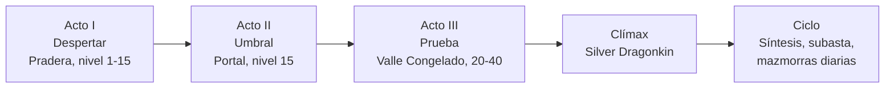
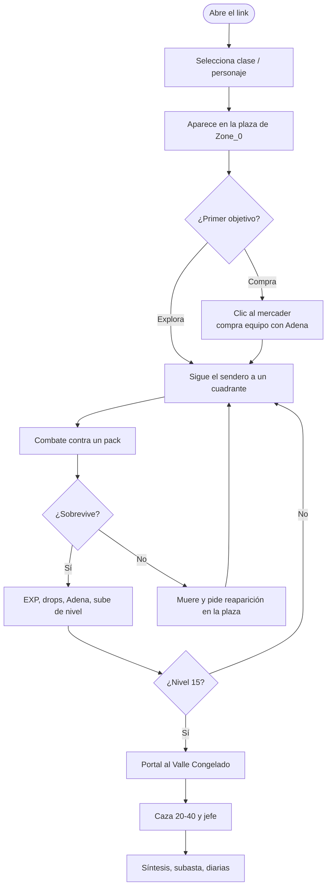

# SDD — Aetheris · Parte 2: Narrativa inmersiva y perspectiva del usuario

> **Estado:** borrador v1. Cubre el apartado 5 del enunciado.
> **Qué es del repo y qué es propuesta:** el blueprint define reglas, zonas y monedas, pero **no tiene relato**. El lore de este documento (5.1) es una **[PROPUESTA]** que reutiliza los nombres que ya existen en el proyecto (Aetheris, Aether-Shards, Adena, los cuatro roles, las zonas). El equipo debe aprobarlo o modificarlo antes de considerarlo definitivo.

---

## 5. Narrativa inmersiva y perspectiva del usuario

### 5.1 Narrativa digital (storytelling)

#### 5.1.1 Premisa

**Aetheris** fue un mundo sostenido por el **Éter**, una energía que hacía que todo lo hecho con esfuerzo perdurara. Un cataclismo, **la Fractura**, lo quebró en **Aether-Shards**: fragmentos de Éter puro que quedaron esparcidos y que hoy alimentan a las criaturas, al equipo encantado y a quien se atreve a recogerlos.

El jugador es un **Despertado**: alguien que vuelve a la vida en la plaza de la Pradera del Novicio, sin memoria clara, con la capacidad de absorber Éter. Su arco es subir desde la pradera hasta el Valle Congelado, donde el **Silver Dragonkin** guarda el fragmento mayor.

| Elemento del juego (existe en el repo) | Función en el relato |
|---|---|
| **Aetheris** | El mundo fracturado. |
| **Aether-Shards** (moneda rara) | Fragmentos del Éter original. Ganarlos es recuperar el mundo. |
| **Adena** (moneda común) | La moneda de subsistencia de los sobrevivientes. |
| **Niveles y EXP** | El Despertado absorbe Éter y recupera fuerza. |
| **Síntesis 2×1 con pity** | Fundir dos objetos para fortalecer uno: el Éter tiende a recomponerse. El pity es "el Éter nunca abandona del todo a quien insiste". |
| **Karma Blanco / Púrpura / Rojo** | El Éter registra cómo se lo usa. Quien lo usa contra otros se tiñe. |
| **Reaparición tras morir** | El Despertado vuelve a la plaza porque el Éter lo recompone. |
| **Portal con nivel mínimo** | La grieta hacia el Valle solo se abre a quien resiste el frío del Éter que hay del otro lado. |

#### 5.1.2 Los cuatro Custodios (los roles del proyecto, dentro del mundo) [PROPUESTA]

Los cuatro sub-agentes del proyecto pueden tener una lectura diegética, es decir, existir dentro del relato. Así el mundo y la arquitectura hablan el mismo idioma y el jugador puede sentir, sin verlas, las reglas del servidor.

| Custodio | En la arquitectura | En el relato |
|---|---|---|
| **El Vigía (The Warden)** | Servidor autoritativo: combate, karma, reglas. | Vela por que nadie haga trampa con el Éter. Es la explicación de por qué el mundo es justo. |
| **El Contador (The Ledger)** | Economía, inventario, síntesis. | Lleva la cuenta de cada moneda y cada objeto. Nada se crea ni se pierde sin registro. |
| **La Tejedora (The Weaver)** | Render, UI, feedback visual. | Da forma visible al Éter: el brillo del arma, el color del nombre. |
| **La Cartógrafa (The Cartographer)** | Zonas, portales, spawns, mazmorras. | Abre y cierra las grietas entre zonas. |

Estos personajes no necesitan aparecer como NPC. Pueden vivir en el texto de los mensajes del sistema, en el log y en el tono del trailer.

#### 5.1.3 Mundo y escenarios

| Zona | Rol narrativo | Atmósfera |
|---|---|---|
| **Pradera del Novicio** (nivel 1–15) | Despertar y aprendizaje. El Éter todavía es débil, los enemigos son "bichos": goblins, arañas, escorpiones. | Luz de día, verde, abierta, segura. |
| **Plaza y mercader** (5, 5) | Refugio y punto de reunión. El mercader y su cofre son la primera cara amistosa. | Cálida, con presencia humana. |
| **Portal** | Umbral. Exige nivel 15. | Tensión y expectativa. |
| **Valle Congelado** (20–40) | Prueba. Esqueletos, zombies, ogros y bull fighters son los que el Éter corrompido dejó atrás. | Frío, blanco, hostil. |
| **Silver Dragonkin** (nivel 40) | Clímax. Guardián del fragmento mayor. | Solitario, imponente, respawn largo. |

#### 5.1.4 Personajes

| Personaje | Rol | Motivación | Arco |
|---|---|---|---|
| **El Despertado** (jugador) | Protagonista. Clases Dark Knight, Dark Wizard o Fairy Elf. | Recuperar fuerza y recordar quién fue. | De novato a cazador de jefes. |
| **El Mercader** (NPC con cofre) | Aliado. | Sobrevivir y comerciar. Es quien le da al Despertado su primer equipo. | Estático, pero es el rostro constante del hogar. |
| **Los mobs** | Antagonistas menores. | Instinto. Cada familia social actúa en manada. | — |
| **El Silver Dragonkin** | Antagonista mayor. | Custodiar el fragmento. | Se enfrenta, cae y reaparece: el mundo es cíclico. |
| **El Despertado Rojo** (otros jugadores) | Antagonista humano opcional. | Poder a cualquier precio. | Arriesga su equipo al morir. |

#### 5.1.5 Estructura del relato: el mundo cuenta, no el texto

Aetheris es un juego de grind. Los MMORPG no cuentan la historia con cinemáticas largas sino con la **escalera de progreso**. La narrativa se apoya en tres capas:

1. **Narrativa emergente:** la historia que cada jugador vive (su primera muerte, su primer +7, su primer PK).
2. **Narrativa ambiental:** ruinas, senderos y clima. Los props Nature + Ruins de las zonas cuentan que hubo una civilización previa: siete muros de ruina en Zone_0, arbustos, piedras, losetas de sendero.
3. **Narrativa mínima escrita:** textos breves del mercader, del log del sistema y del mensaje de portal ("Nivel insuficiente para esta zona"), con el tono de los Custodios.

#### 5.1.6 Arco en tres actos

| Acto | Objetivo del jugador | Emoción | Mecánica que lo sostiene |
|---|---|---|---|
| I. Despertar | Aprender a moverse, pelear y comprar. | Curiosidad, seguridad | Primer combate, mercader, EXP. |
| II. Umbral | Prepararse para cruzar. | Anticipación | Nivel 15 como condición del portal. |
| III. Prueba | Progresar en un mundo hostil. | Tensión, superación | Escalera 22 → 25 → 31 → 36. |
| Clímax | Vencer al Dragonkin. | Triunfo | Jefe de nivel 40. |
| Ciclo | Perfeccionar el personaje. | Maestría, pertenencia | Síntesis, Aether-Shards, diarias, PK. |

---

### 5.2 Inmersión, agencia y transformación (Janet Murray)

Murray, en *Hamlet en la holocubierta* (1997), define tres placeres estéticos de los entornos digitales, que se sostienen sobre cuatro propiedades: procedimental, participativa, espacial y enciclopédica. La tabla los aplica a Aetheris.

#### 5.2.1 Inmersión

> Sensación de estar rodeado por un mundo creíble, que absorbe la atención.

| Recurso | Cómo se logra en Aetheris | Estado |
|---|---|---|
| **Mundo consistente y persistente** | Servidor autoritativo. Lo que pasa es real para todos y no se puede falsear. | Implementado |
| **Coherencia visual** | Assets low poly con iluminación y albedo por zona (pasto, nieve). | Implementado |
| **Presencia de otros** | Otros jugadores visibles en tiempo real en la misma zona. | Implementado |
| **Espacio con lógica** | Cuadrantes de caza alrededor de una plaza, senderos que llevan de la plaza a cada pack. | Implementado |
| **Carga bajo demanda** | El valle nevado no se descarga hasta cruzar el portal: el mundo "se revela". | Implementado |
| **Sonido ambiente** | Casi no hay sonido: solo un tintineo procedural al comprar. | **Falta** (ver Parte 3) |

#### 5.2.2 Agencia

> Capacidad de tomar decisiones y ver que tienen efecto significativo. No es solo interactividad: es que el resultado responda a la intención.

| Decisión del jugador | Efecto visible | Propiedad de Murray |
|---|---|---|
| Elegir clase (Dark Knight, Dark Wizard, Fairy Elf) | Stats y estilo de combate distintos. | Participativa |
| Elegir a qué cuadrante ir a cazar | Riesgo y recompensa distintos. | Espacial |
| Cuándo cruzar el portal | Cruzar a nivel justo es más arriesgado. | Procedimental |
| Comprar, equipar o vender | El paperdoll cambia. | Participativa |
| Arriesgar una síntesis | Puede subir el nivel del ítem o fallar. Tiene pity. | Procedimental |
| Ser Blanco o convertirse en Rojo | Cambia el color del nombre y las consecuencias. | Participativa |
| Elegir cámara de mazmorra (oro / EXP / drop) | Define el tipo de recompensa. *Diseñado, no implementado.* | Procedimental |

**Principio de agencia con integridad:** el cliente envía una intención; el servidor valida. La agencia es real porque el resultado no se puede falsear. Cuando se rechaza una acción, el mensaje es explícito (`LEVEL_TOO_LOW`, `CHARACTER_DEAD`), para que el jugador entienda la causa.

#### 5.2.3 Transformación

> El entorno permite cambiar de identidad, de estado o de perspectiva de manera significativa.

| Nivel de transformación | Cómo se expresa |
|---|---|
| **Del personaje** | Nivel 1 → 40: cambia el poder, el equipo y el brillo del arma (blanco `+1..+3`, azul `+4..+6`, dorado `+7+`). |
| **Moral** | El nombre pasa de Blanco a Púrpura y Rojo según las acciones. Se ve en el mundo y tiene costo económico. |
| **Del espacio** | La Pradera verde se cambia por el Valle blanco: cambio de paleta, de enemigos y de ritmo. |
| **Del jugador** | El Despertado, que no sabía pelear, termina cazando un jefe. |

La transformación más fuerte es el **brillo del arma**: es progreso invertido en tiempo y riesgo, visible para cualquier otro jugador a distancia.

---

### 5.3 Perspectiva del usuario (flujo y POV)

#### 5.3.1 Punto de vista (POV)

- **Tercera persona con cámara elevada** (perspectiva de 50° de campo, con zoom por rueda), con el personaje siempre visible. Se eligió para leer el entorno completo, ver a los mobs que se acercan y mostrar el equipo (el paperdoll es parte de la identidad).
- **Consecuencia narrativa:** el jugador se ve como un personaje, no como un observador. Sostiene la identidad y la transformación visible.
- **Alternativa descartada:** primera persona. Se pierde el paperdoll visible y la lectura de manadas.

#### 5.3.2 Controles principales (implementados)

| Acción | Entrada |
|---|---|
| Mover / interactuar con el mundo | Clic derecho en el suelo (movimiento manual) y sobre el portal. |
| Abrir tienda del mercader | Clic izquierdo sobre el NPC o su cofre (dentro de 4 m). |
| Atacar y habilidades | Teclas `1` a `5`. |
| Inventario | `I` o `Tab`. |
| Hoja de personaje | `P`. |
| Síntesis | `O`. |
| Barra de GM (solo administradores) | `Y`. |
| Cerrar / cancelar | `Esc`. |
| Zoom | Rueda del mouse. |

#### 5.3.3 Flujo del usuario (recorrido de la primera sesión)

#### 5.3.4 Curva de emoción esperada

| Minuto | Momento | Emoción objetivo |
|---|---|---|
| 0–1 | Entra, ve la plaza y su personaje. | Curiosidad |
| 1–3 | Primer combate. | Poder, sorpresa |
| 3–10 | Compra y equipa. | Preparación, pertenencia |
| 10–40 | Caza y sube niveles. | Flow, progreso |
| ~40–60 | Cruza el portal a nivel 15. | Anticipación, asombro |
| Meta | Cae el jefe. | Triunfo |
| Ciclo | Síntesis (éxito o pity). | Tensión → alivio |

*Los tiempos son estimaciones **[HIPÓTESIS]** hasta que se hagan playtests.*

#### 5.3.5 Feedback que sostiene el flujo (teoría del flow)

| Condición del flow | Cómo se cumple |
|---|---|
| Objetivos claros | Siguiente nivel, siguiente zona. |
| Feedback inmediato | Números flotantes de daño, barras de HP y EXP, marco del objetivo, log del sistema. |
| Desafío acorde a la habilidad | Escalera de mobs con niveles ±2 entre packs vecinos. |
| Sensación de control | Click-to-move, hotkeys, mensajes de rechazo explícitos. |

---

### 5.4 Guion para storyboard y trailer (insumo del apartado 8)

Cada viñeta es una captura del juego real con anotación. Sirve tanto para el storyboard como para el guion del trailer.

| # | Plano | Acción | Emoción | Texto / voz en off **[PROPUESTA]** |
|---|---|---|---|---|
| 1 | Cenital sobre la Pradera | Amanecer sobre la plaza. | Calma | "El mundo se rompió." |
| 2 | Primer plano del personaje | El Despertado se incorpora. | Curiosidad | "Pero el Éter no olvida." |
| 3 | Plano medio en la plaza | Clic al mercader, se abre el cofre. | Confianza | "Nadie sobrevive solo." |
| 4 | Combate contra goblins | Golpes, números flotantes. | Poder | "Cada golpe suma." |
| 5 | Camino al portal | Nivel 15 en pantalla. | Anticipación | "Hay algo más allá." |
| 6 | Valle Congelado | Transición del verde al blanco. | Asombro | "El frío lo cambia todo." |
| 7 | Jefe Silver Dragonkin | Enfrentamiento. | Tensión | "Algo guarda el fragmento mayor." |
| 8 | Arma con brillo dorado +7 | Plano del arma. | Triunfo | "Cada fragmento cuenta." |
| 9 | Logo Aetheris | Título. | Cierre | "Aetheris. Despertá." |

---

## Pendientes de esta parte

- [ ] **Aprobar o cambiar el lore** (5.1): la Fractura, el Éter, el Despertado y los cuatro Custodios. Es lo más importante que falta decidir.
- [ ] Confirmar la selección de clase: el prototipo tiene tres clases configuradas, pero no verifiqué si la pantalla de selección existe en el cliente.
- [ ] Validar la curva de emoción y los tiempos (5.3.4) con un playtest.
- [ ] Agregar la cita bibliográfica de Murray (J. H. Murray, *Hamlet on the Holodeck*, 1997; edición en español: *Hamlet en la holocubierta*, Paidós, 1999) y de Csikszentmihalyi para flow.
- [ ] Sacar las capturas del guion (5.4), que también alimentan el storyboard y el trailer.
