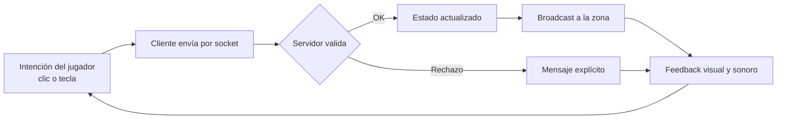

# SDD — Aetheris · Parte 3: Diseño multisensorial e interacción

> **Estado:** borrador v1. Cubre el apartado 6 del enunciado.
> **Honestidad sobre el estado:** lo visual está bastante avanzado, la interacción está definida, pero el **sonido casi no existe**: hoy solo hay un tintineo procedural al comprar. El diseño sonoro de 6.4 es, por lo tanto, una **[PROPUESTA]** a implementar, no una descripción de lo hecho.

---

## 6. Diseño multisensorial e interacción

### 6.1 Estética visual

#### 6.1.1 Dirección de arte

**Fantasía low poly, legible y luminosa**, con dos atmósferas que contrastan. Se prioriza que el jugador lea el espacio y a los enemigos de un vistazo, por encima del realismo.

| Aspecto | Decisión | Por qué |
|---|---|---|
| **Estilo** | Low poly estilizado (packs Quaternius CC0 y algunos modelos CC-BY). | Cabe en el navegador y da coherencia entre assets de distintos autores. |
| **Cámara** | Tercera persona elevada, perspectiva de 50°, zoom por rueda. | Lectura del mapa, del combate y del equipo visible. |
| **Iluminación** | Luz directa simple con materiales Lambert y albedo por zona. | Presupuesto de frame en navegador. |
| **Suelo** | Textura de pasto (Zone_0) y de nieve (Zone_1). | Cambio de zona que se percibe de inmediato. |
| **Interfaz** | Paneles superpuestos (inventario, ficha, síntesis, tienda), barras de HP y EXP, marco del objetivo, log del sistema. | Referencias del género (Lineage 2 / MU). |

#### 6.1.2 Zonas y paleta

| Zona | Paleta dominante | Sensación | Elementos característicos |
|---|---|---|---|
| **Pradera del Novicio** | Verdes vivos, marrones cálidos, cielo claro. | Abierta y segura. | Anillo de árboles y rocas, siete muros de ruina, ~70 arbustos y piedras chicas, senderos de losetas. |
| **Plaza y mercader** | Ocres y madera. | Hogar. | Trader, cofre con animación de apertura. |
| **Valle Congelado** | Blancos, azules fríos, grises. | Hostil, silencioso. | Nieve, packs de esqueletos, zombies, ogros y bull fighters. |

#### 6.1.3 Lenguaje de color como información

| Señal | Color | Qué comunica |
|---|---|---|
| Nombre del jugador | Blanco / Púrpura / Rojo | Estado moral (karma). |
| Brillo del arma `+1..+3` | Blanco frío | Mejora inicial. |
| Brillo `+4..+6` | Azul energético | Mejora intermedia. |
| Brillo `+7+` | Dorado / naranja | Mejora alta, prestigio. |

El color es la señal principal, pero debe mantenerse legible con alto contraste. Para accesibilidad conviene no depender **solo** del color: agregar un icono o texto al estado PvP **[PROPUESTA]**.

#### 6.1.4 Moodboard (a armar por el equipo)

Se sugieren cinco paneles. Las capturas propias las puedo generar yo; las referencias externas las eligen ustedes.

| Panel | Contenido |
|---|---|
| Atmósfera de la Pradera | Capturas propias más referencias de fantasía low poly diurna. |
| Atmósfera del Valle | Capturas propias más referencias de paisajes nevados estilizados. |
| Interfaz | Capturas de Lineage 2, MU Online, MIR4 y de la UI de Aetheris. |
| Criaturas y personajes | Catálogo de mobs, Despertado, mercader. |
| Paleta y tipografía | Verdes de la pradera, blancos y azules del valle, acentos dorados y rojos de estado. |

---

### 6.2 Inmersión y dispositivos

#### 6.2.1 Plataforma elegida

| Decisión | Detalle | Justificación |
|---|---|---|
| **Navegador de escritorio** | Chrome / Edge / Firefox con WebGL (Three.js). | Cero instalación. Es la mayor ventaja frente a los MMORPG clásicos. |
| **Sin VR/AR** | Pantalla plana. | La cámara elevada y el combate por ticks se leen mejor en 2D. Es una decisión de género, no una limitación. |
| **Servidor** | Node/NestJS con Socket.IO. | Mundo compartido en tiempo real. |

#### 6.2.2 Grado de inmersión

La inmersión es de **tipo inmersión narrativa y táctica** (Murray, Ryan): no se busca "estar dentro" físicamente, sino **estar absorbido** por el mundo, la progresión y la comunidad.

| Alternativa evaluada | Ventaja | Por qué no ahora |
|---|---|---|
| **VR** | Presencia física. | Combate por clic y muchos mobs a la vez; exige hardware y mareo. |
| **Móvil** | Alcance. | UI densa; requiere rediseño táctil. **[Trabajo futuro]** |
| **Escritorio (elegida)** | Precisión, teclas de habilidad, pantalla grande. | — |

#### 6.2.3 Presupuesto de rendimiento (afecta a la inmersión)

- Carga de los GLTF **por zona y bajo demanda**: el valle no se descarga hasta cruzar el portal.
- Modelos clonados desde una plantilla en caché, con memoria GPU compartida.
- Piso jugable de 128 m: más mobs en el mismo frustum empeora los picos de lag, por eso no se comprimen los packs.

---

### 6.3 Tipos y diseño de dispositivos de interacción

#### 6.3.1 Dispositivos de entrada

| Dispositivo | Uso | Ventaja |
|---|---|---|
| **Mouse** | Movimiento, interacción con NPC y portales, zoom. | Precisión sobre el terreno. |
| **Teclado** | Habilidades `1–5`, paneles `I`, `P`, `O`, `Esc`. | Velocidad en combate. |
| **Pantalla** | Feedback visual (daño, barras, log). | Lectura continua. |
| **Audio** | Salida de sonido (prevista). | Refuerza la inmersión. |

#### 6.3.2 Esquema de clics

| Clic | Acción | Regla |
|---|---|---|
| **Izquierdo** sobre NPC mercader | Abre la tienda. | Solo si está a ≤ 4 m; el cliente abre la UI cuando el servidor confirma. |
| **Derecho** sobre el suelo | Movimiento manual. | Se rechaza si el personaje está muerto. |
| **Derecho** sobre portal | Viaje entre zonas. | Exige distancia y nivel mínimo. |
| **Derecho** en inventario | Menú contextual de ítems. | Acotado a acciones de inventario. |

#### 6.3.3 Interfaces (HUD y paneles)

| Elemento | Función | Estado |
|---|---|---|
| Barra de HP y de EXP | Estado vital y progreso. | Implementado |
| Marco del objetivo | Vida del enemigo. | Implementado |
| Barra de habilidades (1–5) | Acceso rápido. | Implementado |
| Inventario y paperdoll | Equipo y mochila. | Implementado |
| Ficha de personaje | Stats. | Implementado |
| Panel de tienda | Compra y venta con Adena. | Implementado |
| Panel de síntesis | Fusión 2×1. | En curso (hito A10) |
| Log del sistema | Mensajes, errores, eventos. | Implementado |
| Barra de GM | QA sin grind (`Y`, solo admin). | En curso (hito A10) |

#### 6.3.4 Principios de diseño de interacción

1. **El cliente propone, el servidor dispone:** ninguna acción crítica se resuelve en local.
2. **Cada rechazo se explica:** códigos como `LEVEL_TOO_LOW`, `CHARACTER_DEAD`, `ZONE_MISMATCH` se traducen en mensajes claros.
3. **Un clic, una intención:** el esquema izquierdo / derecho evita ambigüedad.
4. **La interfaz no tapa el mundo:** paneles cerrables con `Esc` o con la misma tecla.

---

### 6.4 Diseño sonoro

> **Estado real:** hoy solo hay un tintineo sintético (oscilador de 920 Hz durante 70 ms) al comprar en la tienda. No hay música ni ambiente ni efectos de combate. Todo lo que sigue es un diseño **[PROPUESTA]** para implementar y para presentar en el trailer.

#### 6.4.1 Principios

- **Sonido como información:** cada evento importante tiene una firma sonora clara (golpe, crítico, muerte, subida de nivel).
- **Sonido como identidad de zona:** cada zona se reconoce con los ojos cerrados.
- **Sin fatiga:** un grind de horas exige música discreta y efectos breves, con volumen configurable.

#### 6.4.2 Paisaje sonoro por zona

| Zona | Música | Ambiente | Sensación |
|---|---|---|---|
| **Pradera** | Melodía suave de cuerdas y flauta, tempo tranquilo. | Viento, pájaros, insectos. | Calma y aprendizaje. |
| **Plaza / mercader** | Motivo cálido (guitarra, percusión leve). | Murmullo, madera, monedas. | Hogar. |
| **Portal** | Zumbido grave que crece al acercarse. | Vibración tonal. | Umbral. |
| **Valle Congelado** | Cuerdas graves, pads fríos, casi sin percusión. | Viento helado, crujido de nieve. | Soledad y amenaza. |
| **Jefe** | Percusión y coro. | Respiración grave y ecos. | Clímax. |

#### 6.4.3 Efectos por evento (lista de assets a conseguir)

| Evento | Sonido | Función |
|---|---|---|
| Golpe melee / skill | Impacto seco, variantes por arma. | Sentir el golpe. |
| Crítico | Impacto agudo más brillo. | Recompensa inmediata. |
| Recibir daño | Golpe sordo más leve distorsión. | Alerta. |
| Muerte del jugador | Descenso tonal más silencio breve. | Peso emocional. |
| Reaparición | Acorde ascendente. | Alivio. |
| Subida de nivel | Fanfarria corta. | Logro. |
| Compra / venta (existe) | Tintineo de monedas. | Confirmación. |
| Síntesis exitosa / fallida | Chispa con acorde / tono seco. | Tensión → alivio. |
| Síntesis por pity | Variante "el Éter responde". | Cierre de la racha. |
| Portal | Zumbido más barrido. | Transición. |
| Rechazo de acción | Clic corto y sobrio. | Aclara sin castigar. |
| Aggro de mob | Rugido / chillido según criatura. | Anticipación. |

#### 6.4.4 Implementación sugerida

- API **Web Audio** o una librería como *Howler.js*, con sonidos en `apps/client/public/audio/`.
- Volumen por canal (música, efectos, ambiente) y opción de silenciar, guardada en el navegador.
- Reproducción disparada por eventos que ya llegan del servidor (daño, muerte, síntesis), sin lógica propia.
- Licencias: preferir CC0 (p. ej. Freesound con filtro CC0, Kenney) y registrar autores en las referencias.

---

### 6.5 Diseño narrativo del entorno

Cómo el espacio cuenta la historia (complementa 5.1.5).

| Recurso | Ejemplo en Aetheris | Lo que cuenta |
|---|---|---|
| **Arquitectura en ruinas** | Siete muros rotos o cubiertos de vegetación en cuadrantes de Zone_0. | Hubo una civilización antes de la Fractura. |
| **Senderos de losetas** | Corredores de plaza a pack; el sendero salta al pasar por el portal. | Alguien recorría estos caminos. |
| **Anillo de árboles** | Borde de la Pradera a ±58 m. | El mundo conocido tiene límite. |
| **Contraste de zonas** | Verde → blanco al cruzar el portal. | La Fractura afectó distinto a cada región. |
| **Jerarquía de enemigos** | Packs por familia social; jefe aislado. | Ecología: manadas vs. guardián. |
| **Puesto del mercader** | Trader + cofre en (5, 5). | Refugio en un mundo roto. |
| **Estado visible del jugador** | Glow de arma, color de nombre. | Historia de cada personaje escrita en el cuerpo. |

**Regla de composición:** el espacio guía sin texto. El sendero lleva al pack, el portal se ve antes de que se pueda usar, el jefe está aparte del resto.

---

### 6.6 Interacción (agencia)

Resumen de cómo la interacción materializa la agencia definida en 5.2.

#### 6.6.1 Ciclo de interacción central

#### 6.6.2 Interacciones por sistema

| Sistema | Interacción | Validación del servidor | Feedback |
|---|---|---|---|
| **Movimiento** | Clic derecho en suelo. | Colisión, zona, vida. | Movimiento interpolado; corrección de posición si es inválido. |
| **Combate** | Teclas `1–5`. | Rango, cooldown, objetivo, facing. | Números flotantes, animación de ataque, barras. |
| **Comercio NPC** | Clic izquierdo al mercader. | Zona, distancia ≤ 4 m. | Apertura del cofre, panel de tienda, tintineo. |
| **Inventario** | `I`, arrastrar, equipar. | Guardas de integridad del paperdoll. | Cambio del modelo y del arma. |
| **Portales** | Clic derecho al portal. | Distancia y nivel mínimo. | Fade de transición o mensaje de rechazo. |
| **Síntesis** | Panel `O`. | Probabilidad y pity solo en servidor. | Resultado confirmado, brillo del ítem. |
| **Karma / PK** | Clic izquierdo sobre otro jugador lo selecciona (marco con su nombre en el color de su karma); la tecla `1` inicia el ataque automático y `Esc` lo cancela. Las habilidades `2–4` también funcionan contra jugadores (con chase a rango y splash de área incluido, excluyendo compañeros de grupo). | Misma zona, alcance de unos 7 m (2,5 de alcance base + 0,85 + 1,8 + 2 de holgura por latencia), enfriamiento del golpe y reglas de karma. | Marco de objetivo, animación de golpe, número de daño, HP conocido tras el golpe y color del nombre. |

#### 6.6.3 Reglas de oro de la agencia

1. Cada acción tiene un **efecto visible** en el mundo.
2. Las **consecuencias son proporcionales** al riesgo asumido (karma escalado por `Value Score`).
3. El sistema **no castiga por mala suerte prolongada** (pity).
4. **Nadie puede falsear resultados:** ni el propio jugador.

---

## Pendientes de esta parte

- [ ] Armar el moodboard (6.1.4). Puedo generar las capturas del juego.
- [ ] **Implementar audio** o, como mínimo, elegir y documentar los assets sonoros que se van a usar en el trailer (6.4).
- [ ] Confirmar la paleta exacta sacándola de las texturas y de la UI real.
- [ ] Verificar el estado de síntesis y GM (hito A10) para que 6.3.3 sea cierto en la entrega.
- [ ] Decidir si hay una nota de accesibilidad (daltonismo, volumen) en el documento final.
