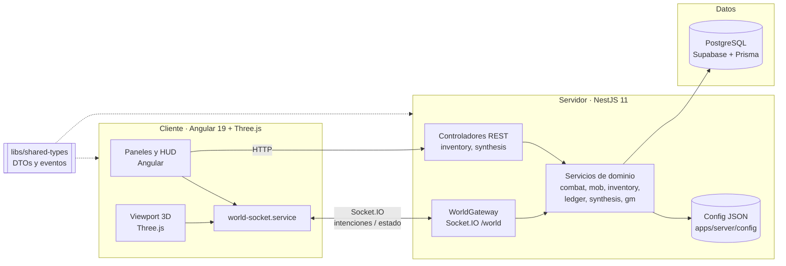
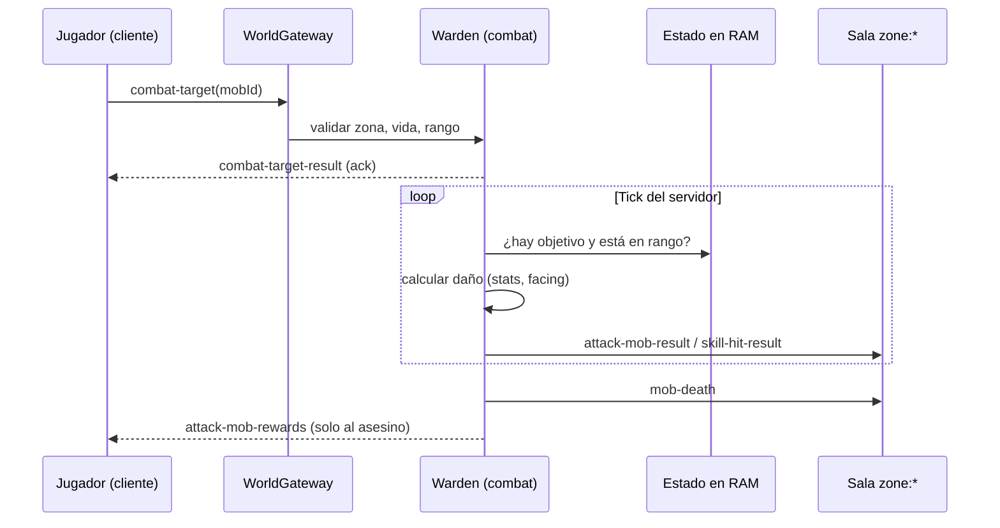
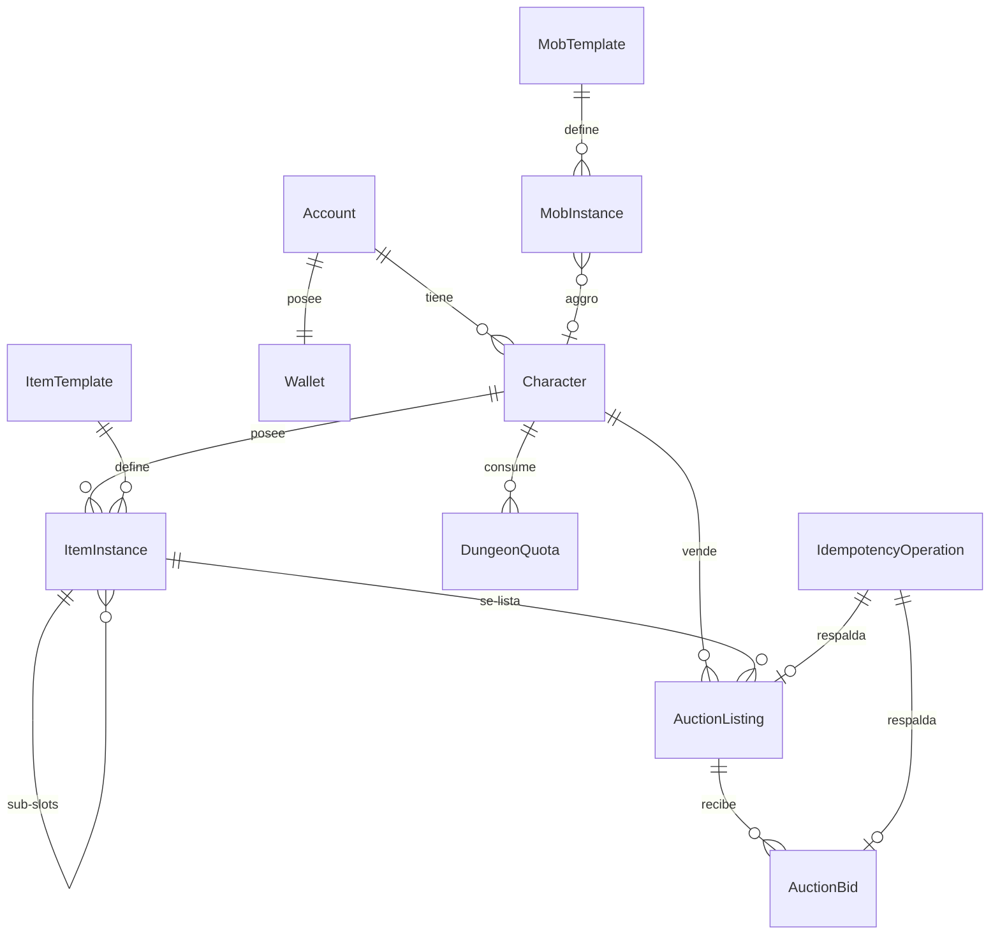
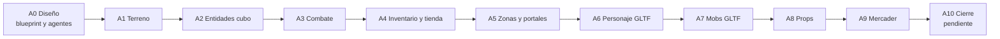

# SDD — Aetheris · Parte 4: Arquitectura técnica y proceso de prototipado

> **Estado:** borrador v1. Cubre los apartados 7 y 8 del enunciado. **El trailer queda pendiente** (se cita en 8.6 con su guion de la Parte 2).
> **Fuentes:** todo lo de este documento sale del código (`apps/server`, `apps/client`, `libs/shared-types`), de `docs/stack.md` y del historial de git. Donde el código y el blueprint no coinciden, se indica.

---

## 7. Arquitectura técnica

### 7.1 Visión general

Aetheris es un monorepo de dos aplicaciones y una librería compartida, con una decisión rectora: **el servidor es la autoridad**. El cliente muestra el mundo y envía intenciones. El servidor las valida, decide y difunde el resultado.

### 7.2 Stack tecnológico

| Capa | Tecnología | Por qué |
|---|---|---|
| Cliente | **Angular 19** (TypeScript 5.7, RxJS, signals) | Estructura para UI de paneles con estado reactivo. |
| Render | **Three.js 0.183** con modelos GLTF/GLB | 3D en navegador sin plugins. |
| Tiempo real | **Socket.IO 4.8** (cliente y servidor) | Bidireccional, con salas por zona y *acks*. |
| Servidor | **NestJS 11** sobre Node | Módulos, inyección de dependencias y gateways WebSocket. |
| Validación | `class-validator` / `class-transformer` con `ValidationPipe` (`whitelist` y `forbidNonWhitelisted`) | Rechazar payloads con campos inesperados. |
| Persistencia | **Prisma 6** + **PostgreSQL** (Supabase) | Tipado y migraciones; plan gratuito. |
| Contrato | **`@aetheris/shared-types`** | Un solo archivo define cada DTO y evento, sin espejos por app. |
| Pruebas | Karma + Jasmine (cliente) | Ver 7.10: la cobertura es baja. |

### 7.3 Estructura del monorepo

| Carpeta | Contenido |
|---|---|
| `apps/server` | NestJS: módulos de dominio, config JSON, migraciones Prisma, scripts de seed. |
| `apps/client` | Angular + Three.js: viewport, servicios de red, paneles UI, modelos en `public/models/`. |
| `libs/shared-types` | Eventos de socket (`world-socket.ts`, unas 640 líneas) y DTOs del API de inventario. |
| `docs/blueprint`, `docs/agents`, `docs/schemas` | Reglas de diseño (fuente única de verdad) y manuales por dominio. |

**Regla del contrato compartido:** el servidor consume la lib como paquete (se compila antes de `build` y `start:dev`); el cliente la consume como fuentes. Al cambiar el contrato hay que reconstruir la lib.

### 7.4 Módulos del servidor

| Módulo | Responsabilidad | Rol funcional |
|---|---|---|
| `world` | Gateway Socket.IO, presencia de jugadores, zonas, portales, tiendas NPC, drops del suelo, respawn de mobs. | Warden / Cartographer |
| `combat` | Auto-ataque, skills, daño, contribución de daño, penalizaciones de grado y karma. | Warden |
| `mob` | Plantillas, spawn por SpawnSpots, IA de patrulla y persecución, regeneración. | Warden / Cartographer |
| `character` | Stats derivados, vitales, regeneración de HP. | Warden |
| `inventory` | Paperdoll, sub-slots, equipar y desequipar, ítems. | Ledger |
| `items` | Catálogo de ítems y su sincronización con la base. | Ledger |
| `ledger` | Botín (loot). | Ledger |
| `synthesis` | Síntesis 2×1 con pity y cotización previa. | Ledger |
| `idempotency` | Evitar operaciones duplicadas en peticiones reintentadas. | Ledger |
| `gm` | Comandos de administración local para QA. | Warden |
| `prisma` | Conexión y servicio de base de datos. | Transversal |

### 7.5 Comunicación en tiempo real

**Namespace:** `/world`. Cada zona es una **sala** (`zone:*`), de modo que el tráfico de una zona no llega a las otras.

| Dirección | Ejemplos de eventos | Patrón |
|---|---|---|
| **Cliente → servidor** (intención) | `player-move`, `attack-mob`, `cast-skill`, `combat-target`, `equip-item`, `pick-item`, `open-merchant-store`, `buy-item`, `sell-item`, `portal-travel`, `request-respawn`, `REQUEST_SYNTHESIS`, `execute-gm-command` | Mucho con **ack**: la respuesta es el valor de retorno del handler. |
| **Servidor → sala de zona** (difusión) | `player-moved`, `mob-moved`, `attack-mob-result`, `skill-hit-result`, `mob-death`, `mob-respawn`, `world-drop-spawn`, `player-death`, `player-respawn`, `player-visual-state` | Todos en la zona ven lo mismo. |
| **Servidor → un socket** (privado) | `zone-snapshot`, `player-vitals`, `player-stats-update`, `attack-mob-rewards`, `attack-mob-denied`, `portal-travel-denied`, `player-position-corrected` | Solo lo que le corresponde al jugador. |

**Secuencia de un ataque** (muestra el principio autoritativo):

### 7.6 Bucles del servidor (ticks)

| Bucle | Intervalo | Función |
|---|---|---|
| IA de mobs (`mob-ai-tick`) | **50 ms (20 TPS)** | Patrulla, persecución y movimiento. Posición y estado 100 % en servidor. |
| Melee de mobs (`mob-combat-tick`) | **50 ms (20 TPS)** | Mobs con aggro intentan golpear; el enfriamiento real vive en RAM. |
| Auto-ataque del jugador (`player-combat-tick`) | **150 ms** | Revisa objetivo y rango; el swing respeta un enfriamiento de 850 ms base (acotado entre 320 y 2400 ms). |
| Guardado de pose de mobs | 2 s | Volcar a la base las posiciones vivas. |
| Guardado de estado de combate | 3 s | Persistir el estado sucio de combate. |
| Regeneración de HP | 5 s | Configurable (`regenIntervalMs`). |
| Barrido de respawn | Configurable | Reconciliar mobs muertos contra la base. |

> **Ajuste respecto al blueprint:** el manual 05 habla de un "loop de 20 TPS" para el combate. En el código, **20 TPS se cumple para IA y melee de mobs**; el auto-ataque del jugador corre a ~6,7 ticks por segundo. No afecta la jugabilidad (el enfriamiento manda) pero el documento final debe decir "20 TPS en IA de mobs" y no generalizarlo.

**Decisión de rendimiento clave:** la posición de los mobs vive en RAM y se vuelca a la base cada 2 s. Un `UPDATE` por mob por tick "tumbaría los 20 TPS" (comentario del código).

### 7.7 Modelo de datos

Base PostgreSQL gestionada con Prisma y **7 migraciones** versionadas.

| Modelo | Contenido |
|---|---|
| `Account`, `Wallet` | Cuenta y monedas (Adena, Aether-Shards). |
| `Character` | Clase, nivel, stats, zona, posición, HP, karma, `isAdmin`. |
| `ItemTemplate`, `ItemInstance` | Catálogo y unidades con ubicación (mochila, paperdoll, sub-slots) y `GearSlot`. |
| `MobTemplate`, `MobInstance` | Plantillas y unidades con estado de IA, `isAlive`, `diedAt`. |
| `NpcInstance` | Mercaderes en el mundo (sin relaciones con otras tablas). |
| `AuctionListing`, `AuctionBid` | Subasta asíncrona (modelo de datos listo). |
| `DungeonQuota` | Cuota diaria de mazmorras (modelo de datos listo). |
| `IdempotencyOperation` | Registro de operaciones para no ejecutarlas dos veces. |

**Integridad económica:** las operaciones sensibles se hacen en transacciones (`$transaction`, 17 usos en el servidor) y con idempotencia para peticiones reintentadas.

**Respawn resistente a reinicios:** la fuente de verdad es la base (`isAlive = false` más `diedAt`), no un temporizador en memoria. Un barrido al arrancar revive lo vencido, y la transición `false → true` es condicional para que no haya duplicados.

### 7.8 Diseño *data-driven*

El balance no está en el código: vive en **19 archivos JSON** en `apps/server/config/`, versionables y revisables sin tocar lógica.

| Grupo | Archivos |
|---|---|
| Mundo | `world-zones`, `world-spatial`, `world-spawn`, `map-objects-Zone_0`, `map-objects-Zone_1` |
| Mobs y combate | `mobs`, `skills`, `combat-damage`, `combat-timing` |
| Personaje | `character-classes`, `character-vitals`, `stat-derivation`, `experience-curve` |
| Ítems y economía | `items`, `equipment-presets`, `npc-shops` |
| Síntesis y karma | `synthesis-tiers`, `synthesis-equipment-bonuses`, `karma-rules` |

Ejemplo: la síntesis define, por nivel, el porcentaje base de éxito, el máximo de fallos consecutivos (pity), el costo en Adena y el bono de stats. Nivel 1: 85 % de éxito, pity a los 4 fallos, 5.000 Adena. Nivel 2: 75 %, pity a los 5, 9.000 Adena.

### 7.9 Decisiones de rendimiento y seguridad

| Tema | Decisión | Efecto |
|---|---|---|
| **Autoridad** | El cliente no resuelve daño, loot, síntesis ni comercio. | Evita trampas de cliente. |
| **Anti-teleport** | `player-position-corrected` devuelve al último punto válido. | Rechaza movimiento inválido. |
| **Validación de entrada** | `ValidationPipe` con `whitelist` y `forbidNonWhitelisted`. | Descarta campos no declarados. |
| **Carga bajo demanda** | Los GLTF y `map-objects` de cada zona se bajan al entrar (`ensureZoneLoaded`). | Menos tiempo de carga inicial. |
| **Memoria GPU** | Modelos clonados desde una plantilla en caché con geometría y materiales compartidos. | Menos memoria por jugador visible. |
| **Texturas de modelos** | Se redujeron a 1024 px las 29 texturas de mobs, mercader y cofre que llegaban a 4096 px (195 MB → 27 MB en disco; de ~1,6 GB de VRAM estimada a una fracción). | Menos memoria de video y menos carga por zona. |
| **Geometría de mobs** | Se simplificaron con meshopt (`gltf-transform`) los modelos más pesados (goblin, goblin2, dog, skeleton, bullfighter, zombie2, dragonkin, mercader), conservando esqueleto y animaciones. Además, las 44 mallas animadas del mercader se fusionaron en 3 (una por material). Triángulos visibles en Zone_0: 393 mil → ~205 mil; llamadas de dibujo: 297 → 257. | Menos carga de GPU sin cambio visible a la distancia de cámara. |
| **Luces** | Se quitó la `PointLight` de aggro de cada mob (19 por zona) y se reemplazó por un aro sin iluminación; las luces de la escena bajaron de ~25 a 6. | Cada luz encarece el shader de todos los materiales. |
| **Piso de 128 m** | Se bajó de 256 m: los 256 m eran "click-to-move a ninguna parte". | Menos vacío y mejor rendimiento. |
| **Tier gratuito** | Índices y paginación previstos en subasta y wallets. | Cuidar lecturas de Supabase. |

### 7.10 Limitaciones y deuda técnica (honesto)

| Tema | Estado |
|---|---|
| **Pruebas** | El servidor no tiene tests. El cliente tiene un único `spec` (`app.component.spec.ts`). Riesgo alto para un sistema con dinero virtual. |
| **Subasta y mazmorras** | Modelos en la base y manuales de diseño listos; **sin lógica implementada**. |
| **Karma, síntesis UI y GM** | Código presente pero sin integrar al historial (hito A10). |
| **Sonido** | Solo un tintineo sintético. |
| **Despliegue** | No hay configuración de despliegue en el repositorio **[COMPLETAR]** dónde se aloja la demo. |
| **Autenticación** | **No hay login.** El socket se identifica solo con el `characterId` (un UUID) en el handshake, y el servidor busca ese personaje. Sirve para el prototipo y las pruebas locales; en un despliegue público, quien conozca un UUID podría manejar ese personaje. Es la prioridad de seguridad antes de abrir la demo. |
| **Íconos de ítems** | Resuelto: los 22 ítems del catálogo tienen ícono SVG propio en `apps/client/public/icons/` (estilo silueta con contorno oscuro; el borde de la casilla ya indica el grado). Falta verificarlos dentro del juego en ejecución. |
| **Creación de personajes** | Solo por script de prueba (`create-test-character.ts [nombre]`); el jugador pega su `characterId` en un campo de texto. No hay pantalla de creación ni selección. Ejecutar el script dos veces con nombres distintos permite probar dos jugadores. |
| **Aceleración por hardware** | El juego necesita WebGL con GPU. Si el navegador la tiene desactivada, el 3D corre por CPU (WARP/SwiftShader): ~9 fps y 90 % de CPU aunque el código sea eficiente. Se detectó en una prueba real; ahora el juego muestra un aviso al detectar renderizado por software, y el panel F3 muestra el renderer y las métricas de cuadro. |
| **Escala** | No hay pruebas de carga; el límite real de jugadores simultáneos es desconocido. |
| **Licencias** | Trader y cofre son CC-BY (atribución obligatoria); el modelo del jugador (lizard man) también es CC-BY-4.0. Conviene una sección de créditos. |

---

## 8. Proceso de prototipado

### 8.1 Enfoque

Prototipado **incremental por capas verticales**: cada hito suma una capa jugable sobre la anterior, empezando por lo más barato (cubos) y reemplazando por arte real al final. Antes de escribir código se definieron las reglas (blueprint) y los roles (agentes).

### 8.2 Línea de tiempo (historial de git)

| Fecha | Hito | Qué se sumó |
|---|---|---|
| 2026-08-17 | **A0** | Arquitectura de agentes y blueprint. |
| 2026-08-26 | **A1** | Terreno base Nest + Angular + Three: piso, cámara, click-to-move. |
| 2026-08-31 | **A2** | Entidades en primitivas y sincronización de zona por socket. |
| 2026-08-31 | **A3** | Combate autoritativo melee y skills. |
| 2026-09-03 | **A4** | Inventario, paperdoll, Adena y tienda NPC. |
| 2026-09-04 | **A5** | Zonas, portales e IA de mobs. |
| 2026-09-05 | **A6** | Modelo GLTF del jugador (lizard y espadón). |
| 2026-09-13 | **A7** | Catálogo visual GLTF de mobs. |
| 2026-09-18 | **A8** | Props de entorno (Nature + Ruins) y albedos de zona. |
| 2026-09-23 | **A9** | NPC mercader (trader + cofre) y catálogo visual. |
| pendiente | **A10** | Síntesis UI, karma, GM y mazmorras (stub). |

Son ~5 semanas de desarrollo. El plan advierte que el árbol de trabajo va por delante del historial: cada avance publica **solo** los archivos de su oleada, para poder mostrar el proceso paso a paso.

### 8.3 Fidelidad por etapa

| Etapa | Fidelidad | Qué se validó |
|---|---|---|
| A1–A2 | **Baja**: piso y cubos. | Que la arquitectura cliente-servidor funciona. |
| A3–A4 | **Media**: sistemas sin arte final. | Combate, economía y tienda. |
| A5 | **Media**: zonas con obstáculos y portales. | Estructura del mundo. |
| A6–A9 | **Alta**: modelos y ambientación. | La identidad visual del entorno. |

**Principio aplicado:** validar primero la mecánica con formas simples; solo después invertir en arte. Es lo que permitió que el cambio de cubos a GLTF fuera aislado: la fábrica de entidades del cliente (`EntityVisualFactory`) es el único punto que se reemplazó.

### 8.4 Decisiones y aprendizajes del proceso

| Decisión / hallazgo | Motivo | Resultado |
|---|---|---|
| Servidor autoritativo desde el día uno. | Evitar rehacer la red cuando hubiera dinero virtual. | Todo el diseño posterior lo respeta. |
| Data-driven en JSON. | Ajustar balance sin recompilar. | 19 archivos de configuración. |
| Primitivas antes que GLTF. | Validar mecánicas sin depender del arte. | Migración aislada en una sola clase. |
| Pose de mobs en RAM con volcado periódico. | Un `UPDATE` por tick no escala. | Se sostiene el movimiento a 20 TPS. |
| Modelos de arte externo sin optimizar (texturas de 4096 px, hasta 80 mil triángulos por mob). | Aparecieron como CPU/GPU al 75-90 % al sumar mobs y mercader; se midió con Chrome headless y `renderer.info`. | Reducción de texturas y geometría; regla nueva: optimizar todo asset antes de sumarlo. |
| Deadlock de Postgres (40P01) cuando dos jugadores se pegaban a la vez. | Cada golpe actualizaba primero al atacante y luego al objetivo: A→B y B→A se bloqueaban en cruz. | Se bloquean ambas filas en orden fijo por id al inicio de la transacción, un solo golpe PvP en curso por atacante y timeout de transacción mayor. Verificado con una prueba de ataques cruzados simultáneos. |
| Piso de 256 m → 128 m. | El espacio extra estaba vacío. | Mejor densidad y rendimiento. |
| No comprimir los packs hacia el centro. | Más GLTF en el mismo frustum empeora el lag. | Cuadrantes separados. |
| Respawn desde la base, no desde temporizadores. | Sobrevivir a reinicios del proceso. | Sin mobs muertos para siempre. |
| Muerte y reaparición en dos fases. | Que el jugador vea su muerte antes de volver. | `player-death` y `request-respawn` separados. |
| Cuadrantes con corredores y senderos. | Guiar sin texto. | Losetas de sendero sin colisión. |
| Assets CC0 y CC-BY con atribución. | Sin costos de arte. | Requiere sección de créditos. |

### 8.5 Estado del prototipo y qué se puede demostrar

| Funciona (demostrable) | En curso o pendiente |
|---|---|
| Mundo multijugador en tiempo real con salas por zona. | Síntesis (UI), karma y GM (A10). |
| Combate autoritativo: auto-ataque, skills, daño flotante, muerte y reaparición. | Mazmorras diarias (solo diseño). |
| Inventario, paperdoll, Adena, tienda NPC y botín en el suelo. | Subasta y Aether-Shards (solo diseño). |
| Dos zonas con portales, requisito de nivel y jefe. | Sonido y música. |
| Mobs con IA (patrulla y persecución) y respawn persistente. | Tests automáticos. |
| Modelos GLTF de personaje, mobs, props y mercader. | Despliegue público. |

### 8.6 Trailer *(pendiente)*

El apartado 8 exige un trailer "a manera de publicidad del futuro". **No está hecho.** Insumos disponibles:

- Guion de 9 viñetas con emoción y voz en off en `docs/sdd/parte-2-narrativa.md` (5.4).
- Capturas del juego real (por generar).
- Propuesta de paisaje sonoro en `docs/sdd/parte-3-multisensorial.md` (6.4).

**Decisión pendiente:** "publicidad del futuro" puede interpretarse como mostrar el juego terminado (incluyendo lo que aún no existe, como mazmorras y subasta) o solo lo demostrable. Recomendación: mostrar lo real y sugerir el futuro con un cierre tipo "próximamente".

### 8.7 Próximos pasos

1. Cerrar A10 (síntesis UI, karma, GM) y documentar el estado final.
2. Implementar audio mínimo (impacto, muerte, subida de nivel, portal) para el trailer.
3. Escribir tests del servidor en las operaciones con dinero (síntesis, tienda, subasta).
4. Definir el despliegue de la demo para la presentación final.
5. Playtest con 5 a 8 personas para validar las personas y la curva de emoción de las Partes 1 y 2.

---

## Pendientes de esta parte

- [ ] Completar dónde se aloja la demo (7.10).
- [ ] Ajustar la redacción de "20 TPS" en el documento final (7.6).
- [ ] Exportar los cuatro diagramas Mermaid a PNG.
- [ ] Hacer el trailer (8.6).
- [ ] Decidir si se mantiene la sección 8.7 o se convierte en "trabajo futuro" de la conclusión.
